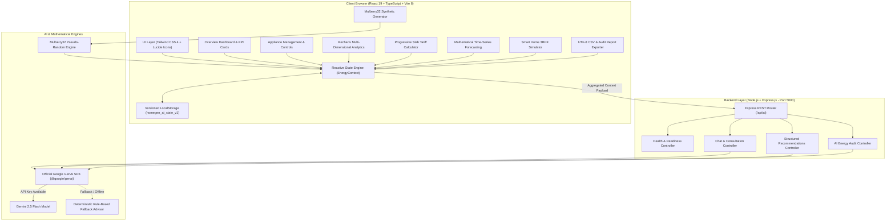
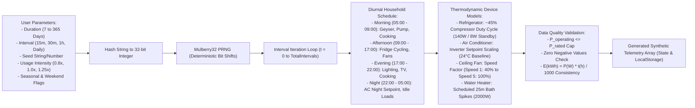
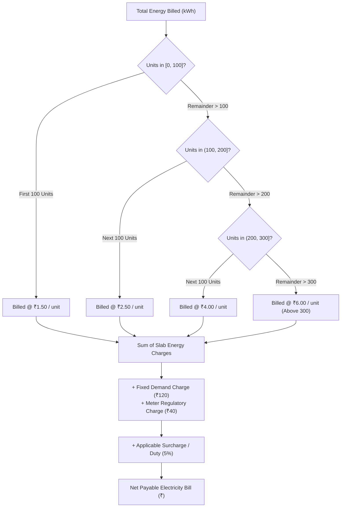
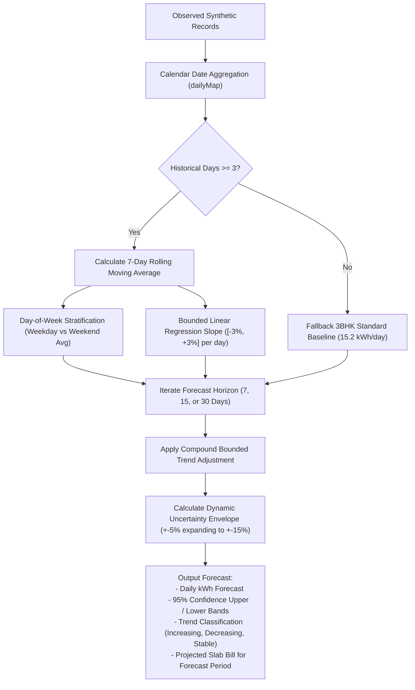

# HomeGen AI – AI-Powered Home Energy Management System

> **Tagline:** *Monitor. Control. Predict. Optimize.*

HomeGen AI is an educational, production-style academic demonstration web application designed to simulate, monitor, analyze, and optimize residential electricity consumption. The platform combines reproducible synthetic telemetry generation, appliance-level submetering, progressive slab electricity bill estimation, mathematical time-series forecasting, interactive smart home simulation, and Google Gemini AI insights.

> [!IMPORTANT]
> **Academic Simulation Mandate:** HomeGen AI is a **pure software simulation**. It operates without physical meters, ESP32 microcontrollers, current transformers, or hardware relays. All appliance telemetry readings, live monitoring graphs, and control operations are deterministic mathematical simulations engineered for academic demonstration.

---

## 1. System Architecture & Workflows

### End-to-End System Architecture



---

### Synthetic Data Generation Engine Workflow



---

### Progressive Slab Billing Allocation Pipeline



---

### Time-Series Prediction Forecasting Pipeline



---

## 2. Key Features

1. **Overview Dashboard:** Live KPI cards for total energy (kWh), simulated demand (kW), estimated electricity bill (₹), active appliances, energy saved, and household efficiency score. Interactive Recharts graphs for hourly diurnal profiles, appliance donut contributions, daily consumption comparisons, and power trends.
2. **Appliance Management:** Dynamic inventory of 13+ default residential appliances across 9 rooms and 7 categories. Simulated ON/OFF switches, runtime adjustments, and editable rated powers with immediate live demand recalculation.
3. **Synthetic Energy Data Generator:** Fully local, reproducible synthetic telemetry engine powered by the **Mulberry32 PRNG**. Supports 7, 30, 90, 180, and 365-day durations, 15m/30m/1h/daily intervals, usage intensity factors (low, normal, high), seasonal adjustments, and appliance duty cycling (compressors, HVAC inverter stages, fan speed modulation).
4. **Energy Analytics:** Multi-dimensional exploratory analytics filtering by time range (7d, 30d, 90d, all), room zone, and category. Includes day-of-week stratification and peak load spike identification.
5. **Electricity Bill Estimator:** Progressive slab-based tariff calculator with editable consumption tiers and rates (demonstration tariff: First 100 @ ₹1.50, Next 100 @ ₹2.50, Next 100 @ ₹4.00, Above 300 @ ₹6.00), flat tariff comparison, regulatory surcharge modeling, and individual appliance marginal cost calculators.
6. **AI Energy Prediction:** Multi-horizon forecasting (7-day, 15-day, 30-day) using rolling moving averages, day-of-week stratification, bounded linear trends, and 95% confidence intervals.
7. **Smart Home Simulator:** Room-by-room HVAC temperature setpoint sliders (16°C - 30°C with ~6% thermodynamic power scaling per °C), fan speed regulators, and 4 one-click simulated scenarios (Normal, Energy Saving, Peak, Vacation) with live savings delta evaluation.
8. **Google Gemini AI Assistant:** Interactive conversational advisor integrated with the official `@google/genai` TypeScript SDK. Provides prioritized energy-saving recommendations and audit report generation with a deterministic offline rule-based fallback.
9. **Dataset Explorer:** Searchable, sortable, and paginated data table for inspecting individual interval records with full integrity audit summaries.
10. **Reports & CSV Export:** Downloadable UTF-8 CSV exports for:
    - Complete raw synthetic telemetry
    - Appliance-wise consumption
    - Daily consumption summary
    - Electricity bill statements
    - Predictive forecast models
    - Scenario simulation comparisons
    - Printable formal audit report statements (`window.print()`).
11. **Settings & Data Management:** Configure household layout (3BHK rooms), export/import JSON state backups, and manage browser LocalStorage persistence.
12. **About Project Page:** Complete documentation covering objectives, problem statement, proposed solution, system architecture, engineering calculation formulas, technology stack, and limitations.

---

## 3. Technology Stack

| Layer | Technologies |
|---|---|
| **Frontend** | React 19, TypeScript, Vite 8, Tailwind CSS 4, React Router 7, Recharts, Lucide React |
| **Backend** | Node.js, Express.js, TypeScript, CORS, Dotenv |
| **Generative AI** | Google Gemini API via official `@google/genai` SDK (`gemini-2.5-flash`) |
| **Data Engine** | Mulberry32 Seeded Pseudo-Random Number Generator, Mathematical Energy Models |
| **Storage** | Versioned Browser LocalStorage (`homegen_ai_state_v1`), JSON Import/Export |
| **Testing** | Vitest, Supertest |

---

## 4. Directory Structure

```
d:/gopu/
├── backend/
│   ├── src/
│   │   ├── config/index.ts            # Environment configuration
│   │   ├── controllers/aiController.ts # REST controllers for chat, insights, report, health
│   │   ├── routes/aiRoutes.ts         # /api/ai Express routes
│   │   ├── services/geminiService.ts  # @google/genai SDK integration & rule-based fallback
│   │   ├── tests/api.test.ts          # Supertest backend test suite
│   │   └── server.ts                  # Express server entry point (Port 5000)
│   ├── .env.example                   # Environment configuration template
│   ├── package.json
│   └── tsconfig.json
│
├── frontend/
│   ├── src/
│   │   ├── components/                # Layout (Sidebar, TopNav, AppLayout) & Common components
│   │   ├── constants/defaultData.ts   # Default 3BHK layout, 13 default appliances, demonstration tariffs
│   │   ├── context/EnergyContext.tsx  # Global state provider & reactive calculations
│   │   ├── pages/                     # 12 navigation page components
│   │   ├── services/                  # energyService, predictionService, exportService, storageService, geminiService
│   │   ├── types/index.ts             # TypeScript definitions
│   │   ├── utils/                     # calculations.ts, randomGenerator.ts
│   │   ├── App.tsx                    # Routes
│   │   ├── main.tsx                   # React root mount
│   │   └── index.css                  # Tailwind 4 design system with dark/light themes
│   ├── tests/calculations.test.ts     # Vitest calculations and PRNG test suite
│   ├── index.html
│   ├── package.json
│   ├── tsconfig.json
│   └── vite.config.ts
│
├── package.json                       # Root monorepo scripts
├── README.md                          # Full academic documentation
└── .gitignore
```

---

## 5. Engineering Calculation Formulas

HomeGen AI employs consistent, mathematically validated energy and billing formulas:

### A. Energy Consumption
$$E\,(\text{kWh}) = \frac{P\,(\text{W}) \times t\,(\text{hours})}{1000}$$

### B. Instantaneous Total Power Demand
$$\text{Demand}\,(\text{kW}) = \frac{\sum_{i=1}^{N} P_{\text{operating}, i}\,(\text{W}) \times Q_i}{1000}$$

### C. Progressive Slab Tariff Billing
$$\text{Total Energy Charge} = \sum_{k=1}^{M} (\text{Units in Slab}_k \times \text{Rate}_k)$$
$$\text{Total Estimated Bill} = \text{Energy Charge} + \text{Fixed Charge} + \text{Additional Surcharges} + \text{Duty / Tax}$$

### D. Energy Savings Delta
$$\text{Energy Saved}\,(\text{kWh}) = \max(0,\, E_{\text{baseline}} - E_{\text{optimized}})$$

### E. Savings Percentage
$$\text{Savings}\,\% = \left(\frac{\text{Energy Saved}}{E_{\text{baseline}}}\right) \times 100$$

### F. Individual Appliance Monthly Cost
$$\text{Monthly Cost}\,(\text{₹}) = \left(\frac{P\,(\text{W}) \times t_{\text{daily}}\,(\text{h}) \times 30}{1000}\right) \times \text{Effective Tariff Rate}$$

---

## 6. Quick Start Instructions

### Prerequisites
- Node.js (version 18+ or 20+; tested on Node v24)
- npm (version 9+)

### Installation
From the root workspace directory (`d:/gopu`):
```bash
# Install root orchestration packages
npm install

# Install frontend dependencies
cd frontend && npm install

# Install backend dependencies
cd ../backend && npm install
```

### Starting the Application (Frontend + Backend)
Run the monorepo dev script from the project root:
```bash
npm run dev
```
This simultaneously starts:
- **Frontend client:** `http://localhost:5173`
- **Backend API server:** `http://localhost:5000`

---

## 7. Google Gemini AI Configuration

HomeGen AI is integrated with the official `@google/genai` TypeScript SDK.

1. Obtain an API key from Google AI Studio ([https://aistudio.google.com/](https://aistudio.google.com/)).
2. Open `backend/.env` (or copy from `backend/.env.example`).
3. Add your key:
   ```env
   PORT=5000
   GEMINI_API_KEY=your_gemini_api_key_here
   GEMINI_MODEL=gemini-2.5-flash
   ```
4. Restart the backend.

> [!NOTE]
> **Zero-Configuration Fallback:** If `GEMINI_API_KEY` is not provided or the network is unavailable, HomeGen AI automatically switches to its built-in rule-based advisory engine. All recommendations, chat queries, and audit reports function completely without throwing errors or blocking navigation.

---

## 8. Running the Test Suite

Execute the full automated test suite covering electrical formulas, slab tariffs, Mulberry32 PRNG reproducibility, prediction bounds, CSV escaping, and backend REST endpoints:

```bash
# Run all tests across frontend and backend from the root:
npm run test
```

---

## 9. Academic Disclaimer & Limitations

- **Simulation Only:** All data values are synthetically generated.
- **Demonstration Tariff:** Tariff slabs represent illustrative residential tier structures and do not constitute legal contracts with utility providers.
- **Academic Citation:** Designed as a final-year software capstone / academic demonstration platform for smart grid and home energy management coursework.
